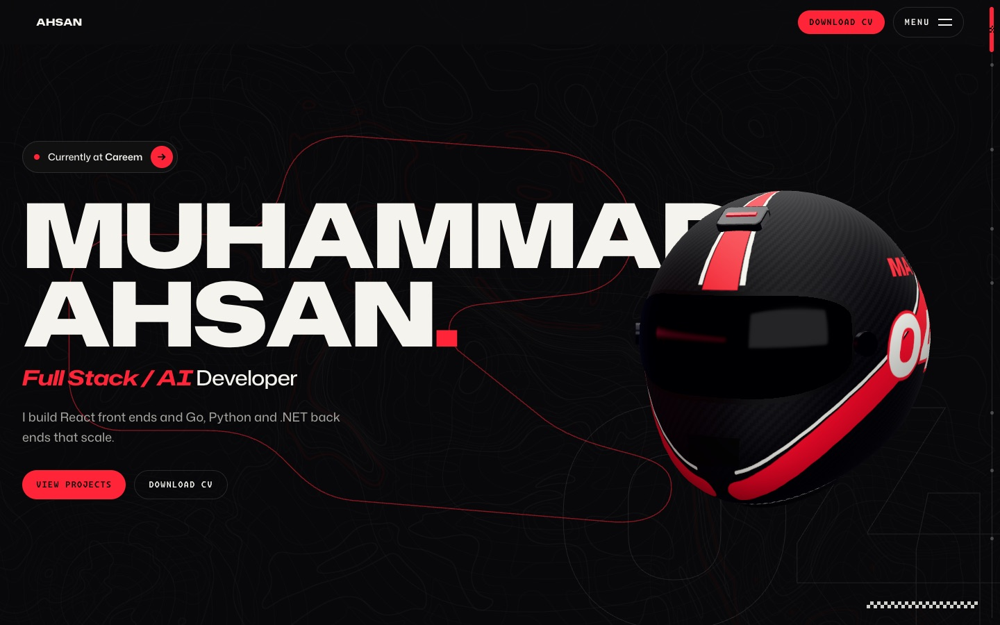
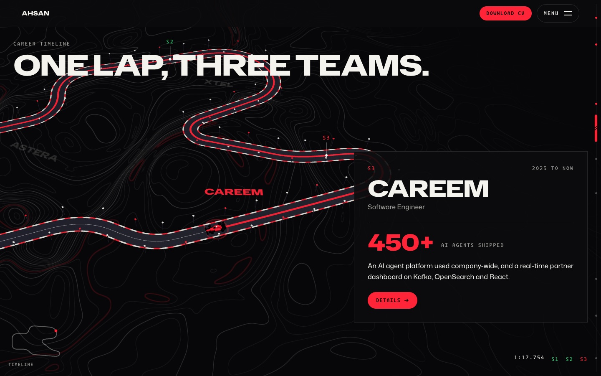
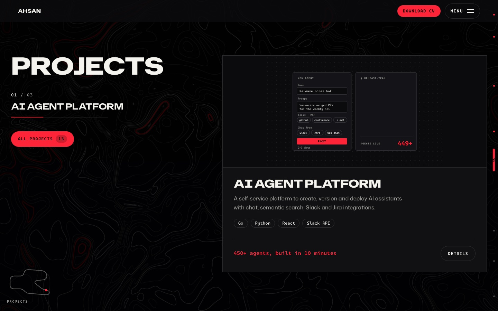
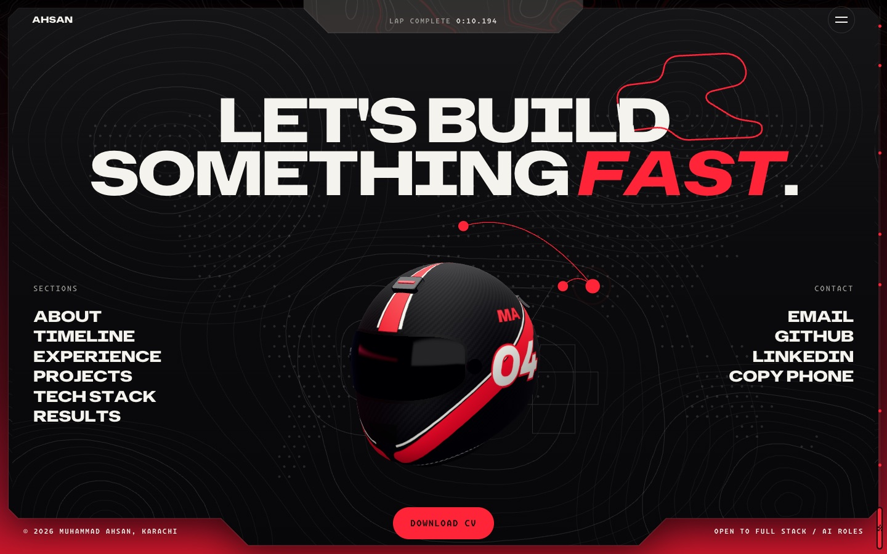
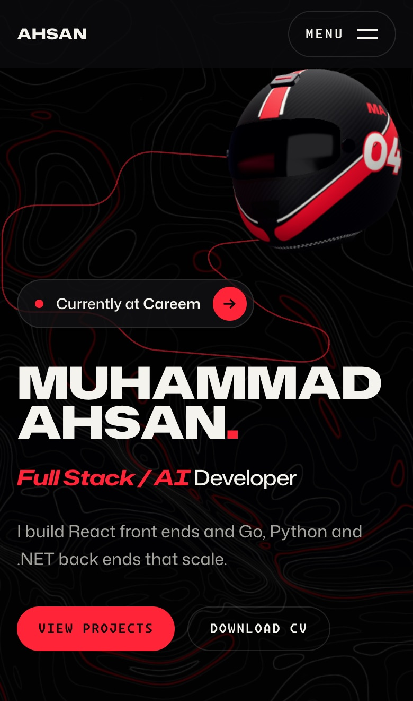

# Muhammad Ahsan · Full Stack / AI Developer

My portfolio, built as a race: start lights, one lap of a 3D circuit for my career, and a
finish line. Live at **https://muhammad-ahsan-dev.vercel.app**.



## The idea

The page is a race weekend told in developer terms. The intro is a set of F1 start lights. The
hero has a carbon helmet with the number 04. The career timeline is one lap of a circuit,
**one lap, three teams**, with a sector per job. The page ends at the finish, which shows your
lap time: how long you took to reach it.

The racing is only the visual layer. Every heading, menu item and section id uses plain
developer terms (About, Career timeline, Work experience, Projects, Tech stack, Results,
Contact). The F1 details are decorative and `aria-hidden`, so search engines and screen readers
see a plain developer portfolio. The look takes cues from landonorris.com.

| The lap: career timeline | Projects |
| --- | --- |
|  |  |

**The finish** (left): the last screen is a card in a red frame, with the helmet parked in it
and your lap time in the tab at the top. **On a phone** (right): the same page, with the helmet
above the name.

<p align="center">
  
  
</p>

## Design decisions

- **One livery, no second colour.** Carbon `#0b0b0c`, graphite `#111113`, chalk `#f4f4ed` and
  one race red `#ff2438`. There's no blue and no extra accent; red marks the live thing (the
  current job, the active sector, the main button). The 3D lap and the footer sit on a darker
  "pit" ground, `#070708`. The values live in `src/index.css` and, for SVG, canvas and WebGL,
  in `src/art/palette.ts`.
- **Type like a team's livery.** Three GitHub families: Hubot Sans, expanded, for the big
  headings; Mona Sans for text; Monaspace Krypton for labels, buttons and numbers, so data reads
  like a timing screen. They're self-hosted, trimmed to the weights in use and preloaded.
- **Timing-screen colours.** Lap sectors turn green when done and purple for the best one, as
  on an F1 timing screen. The lap clock counts with your scroll and runs backwards when you
  scroll up.
- **Motion that follows the scroll.** Animation is tied to scroll position rather than timers:
  the lap, the parallax and the headings that lean with scroll speed. The logo marquee moves
  only while you scroll. Everything uses one engine (GSAP, with Lenis smooth scroll on its
  ticker) and one set of durations and eases.
- **3D built in code, nothing downloaded.** The helmet, the car, the track and their paint are
  made in code; there are no 3D models or texture files to load.
- **Fast on purpose.** The HTML is prerendered, so the page reads before any JavaScript runs.
  three.js is lazy-loaded in its own chunk, shaders compile in idle time, and the WebGL canvases
  draw only while something moves. They pause when the tab is hidden or a dialog is open, and
  the resolution drops on frames that miss their deadline.
- **Calm by request.** With reduced motion (or `?nomotion`) the page is static and complete.
  WebGL is skipped for reduced motion, Save-Data, weak devices or no WebGL2, and the page reads
  the same without it.

## The 3D layer

Two transparent canvases, one behind the page and one in front of it (click-through):

- **Contour field.** A full-screen shader draws a topographic map: warped noise as smooth
  contour lines, a brighter line every fifth, and one red racing line. On desktop the map
  magnifies around the cursor, and fast scrolling stretches it like speed.
- **The helmet.** A procedural shell with its livery painted in code onto the UV layout: the
  centre stripe, the side swooshes with a white pinstripe, the 04 and the initials, over a
  carbon weave. Its reflections come from a pit garage, also built in code (a dark box of strip
  lights, one of them red), baked once into an environment map. It dissolves in from wireframe
  to solid with a glowing seam, then flies down the page along curves between layout slots in
  the text, and parks in the footer.
- **The lap.** The career timeline becomes a 3D circuit: an asphalt ribbon with red and white
  kerbs and trackside lights. An aerial "broadcast" camera makes a slow quarter orbit as you
  scroll. A low-poly F1 car with a blinking rain light drives one sector per job, and light
  pulses run along the racing line, brighter the faster you scroll. Each company's name is
  painted on the run-off beside its sector, and the S1/S2/S3 marks are projected from the 3D
  track onto the page.

## Tech stack

| Area | Used |
| --- | --- |
| UI | React 19, TypeScript 7, Tailwind CSS 4 |
| Build | Vite 8, an SSR build and a prerender step (`scripts/prerender.ts`) |
| 3D | three.js (WebGL2, custom GLSL shaders) |
| Motion | GSAP 3 (ScrollTrigger, SplitText, DrawSVG, ScrambleText, Flip, MotionPath), Lenis |
| Graphics | Hand-written SVG scenes, simple-icons, a dotted world map precomputed by a script |
| Quality | `tsc -b`, oxlint with type-aware rules |
| Hosting | Vercel, with Web Analytics and Speed Insights |
| SEO | Prerendered HTML, JSON-LD `Person`, canonical and Open Graph tags, `sitemap.xml` |

## Run it

You need Node.js 22.12 or newer (Vite 8 also runs on 20.19+).

```bash
npm install
npm run dev        # http://localhost:5174
npm run build      # client build + SSR build + prerender into dist/
npm run preview    # serve dist/ at http://localhost:4174
npm run check      # typecheck + lint (both must pass with no warnings)
```

**Debug flags:** `?nointro` skips the start lights · `?nomotion` static page · `?nogl` no
WebGL · `?debug` ScrollTrigger markers.

**Content:** all the copy is in `src/content/data.ts`, including `SECTIONS`, the one list of
page sections that the menu, the track map and the scroll rail read.

## Deploy

Vercel builds `main` on every push with `npm run build` and serves `dist/` (`vercel.json`;
hashed files under `assets/` are cached for a year). The prerender writes the canonical and
Open Graph tags, `sitemap.xml` and the `Sitemap:` line in `robots.txt` for `SITE_URL` in
`src/content/data.ts`, or, when that's empty, for the production domain Vercel passes in.

## Under the hood

```
src/
  components/   nav and menu, dialogs, cursor, scroll rail, track map, start lights, SVG scenes, world map
    sections/   Hero, About, Lap (career timeline), Experience, Projects, TechStack, Results, Contact
  content/      data.ts: every word on the page
  gl/           three.js: Stage (render loop), field, lap, car, run-off, garage, helmet/, flight/
  motion/       GSAP setup, smooth scroll, shared patterns and tokens
  art/          palette, the circuit's path, world-map dots
  lib/          focus trap, lap-time format, idle callback
scripts/        prerender, font trimming, world-map dots
```

- **Scroll:** Lenis smooth scroll runs from the GSAP ticker and updates ScrollTrigger in the
  same frame (`src/motion/SmoothScroll.tsx`), so pins, scrubbed tweens and WebGL never drift.
- **Motion patterns:** `src/motion/patterns.ts` (SplitText masked reveals, clip-path wipes,
  scrubbed parallax, digit rolls, DrawSVG lines, `gridSlot`, the scrubbed letter-by-letter
  heading entrance, `barReveal`, the red bar line reveal, and `curtainReveal`, the oval curtain
  on project visuals). Sections use them through `useSectionMotion`, which does nothing with
  reduced motion. Display headings marked `data-speed` lean with scroll speed
  (`src/motion/useSpeedSkew.ts`); button and menu labels marked `data-letter-roll` roll their
  letters on hover (`src/motion/useLetterRoll.ts`); Projects becomes a CSS-sticky card deck when
  a card fits the screen; the custom cursor is `src/components/Cursor.tsx` (states via `data-cursor`).
- **Intro:** F1 start lights (`src/components/Intro.tsx`) play the shared timeline in
  `src/motion/intro.ts`. First visit only; skipped with a URL hash, `?nointro` or reduced motion.
- **WebGL:** lazy-loaded three.js (`src/gl/Stage.ts`) on two canvases. Behind the page: the
  contour-line background, or the 3D lap while it is pinned. Above the page, see-through and
  click-through: the procedural helmet (`src/gl/helmet/`), so it can fly in front of the text.
  It flies cubic Béziers between layout boxes marked `data-helmet-anchor` (the hero, a slot
  after "fast." in About, the P3 step, beside 450+), in back-to-back scroll windows
  (`src/gl/flight/route.ts`, `flight.ts`).
- **One animation engine:** every JS animation is GSAP (plus Lenis on its ticker). Counters use
  `digitRoll`, scrambled labels `ScrambleTextPlugin` (`src/components/Scramble.tsx`), project
  cards play a short SVG scene of the product in use (`src/components/ProjectVisuals.tsx`: the
  markup is the last frame; it loops only while on screen, once on touch). In the details
  dialogs each row lands as it scrolls into view: its stat rolls and, where the highlight has a
  before/after `delta` in `data.ts`, two bars race at the same speed (`src/components/Dialogs.tsx`).
  The Contact map grows out of Karachi and draws an arc to each place worked with
  (`src/components/WorldMap.tsx`). Durations and eases come from `src/motion/tokens.ts`; CSS
  hover transitions share them through `--dur-hit`, `--dur-split` and `--dur-wipe`.
- **Shared pieces:** GLSL used by more than one shader (noise, the contour isolines, the
  helmet's dissolve edge) is in `src/gl/glsl.ts`; small helpers (focus trap, lap-time format,
  idle callback) are in `src/lib/`. Both dialogs are one `DialogFrame`.
- **Type:** fonts are self-hosted from `src/assets/fonts/`, trimmed by `scripts/fonts.py` to the
  weights and widths in use (which also makes every zero plain), and preloaded (the plugin in
  `vite.config.ts`). Display sizes are the `--text-display-*` roles in `src/index.css`. Arrows
  are the `<Arrow />` SVG, because the → character isn't in the fonts.
- **Linting:** `npm run lint` runs [oxlint](https://oxc.rs/docs/guide/usage/linter) with
  type-aware rules (`oxlint-tsgolint`); `npm run lint:fix` applies the safe fixes. It is oxlint
  rather than ESLint because typescript-eslint parses through the TypeScript compiler API, which
  TypeScript 7 doesn't ship. Rules and the reason for each override are in `.oxlintrc.json`.
- **Social card and touch icon:** `public/og.jpg` and `public/apple-touch-icon.png` are stills
  made from the site's own type, contours and helmet. No video is used on the site.
