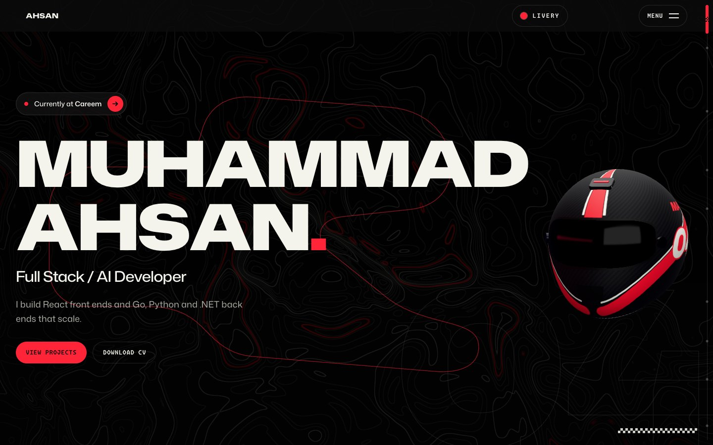
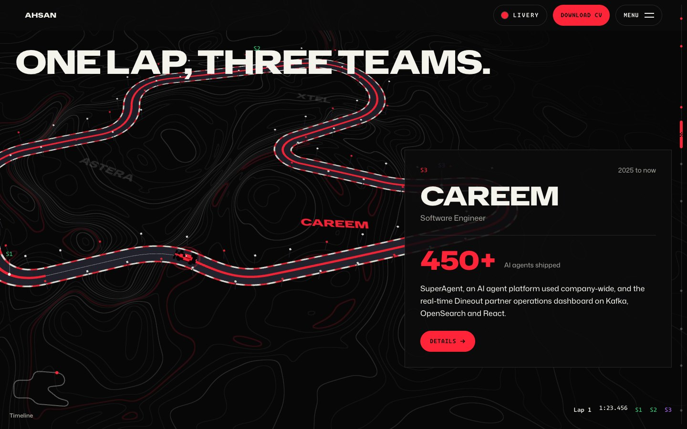
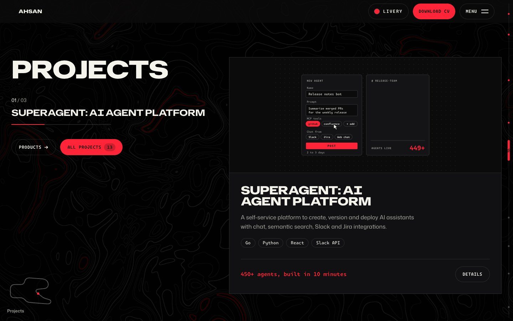
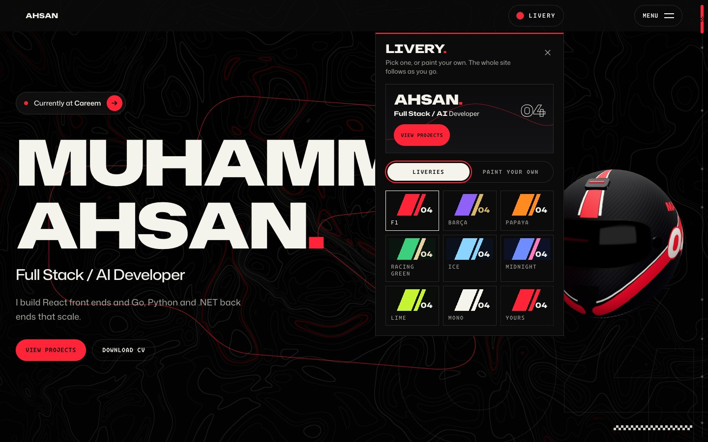
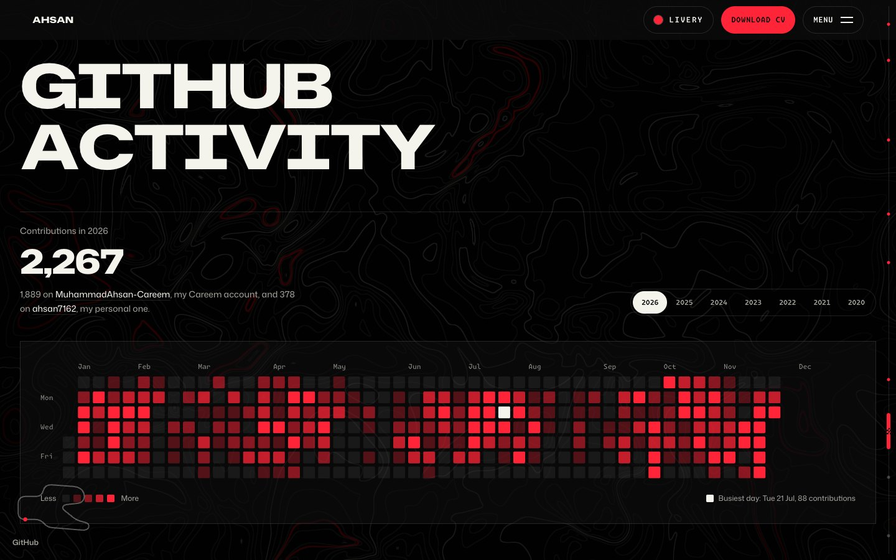
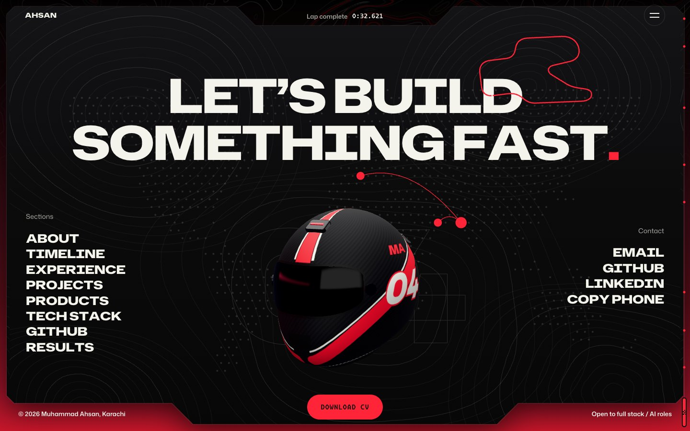
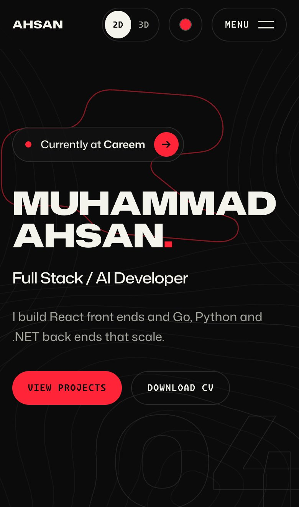
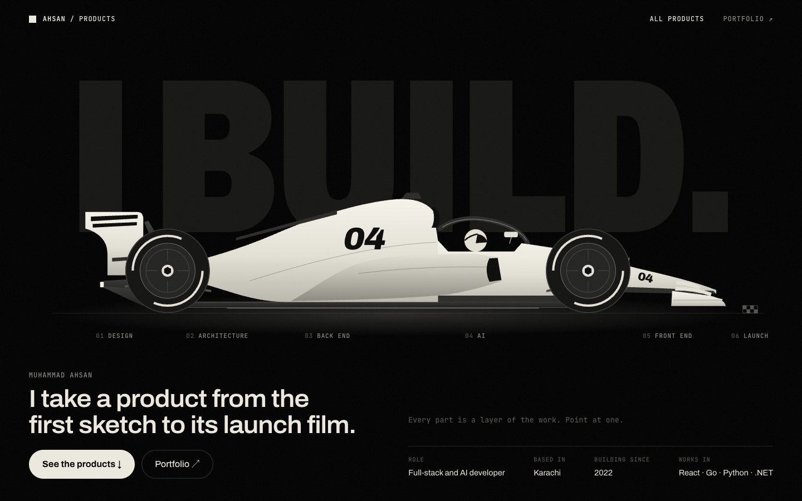
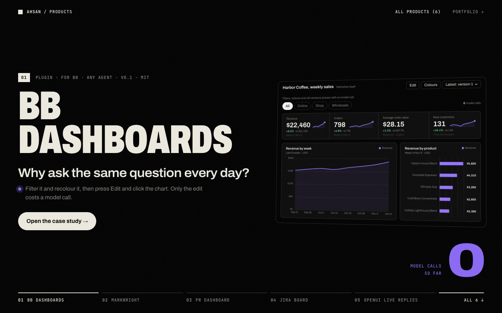
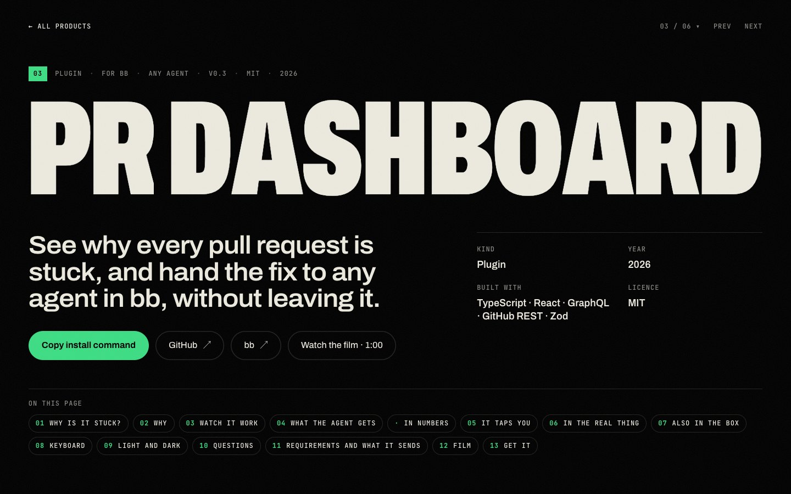

# Muhammad Ahsan · Full Stack / AI Developer

My portfolio and my products, in one site. The portfolio is a race: start lights, one lap of a 3D
circuit for my career, and a finish line. The products section shows the six plugins I've built
for [bb](https://getbb.app), each one with a demo you can use in the page.

**Live:** [muhammad-ahsan-dev.vercel.app](https://muhammad-ahsan-dev.vercel.app) ·
[/products](https://muhammad-ahsan-dev.vercel.app/products)

React 19 · TypeScript 7 · Vite 8 · Tailwind CSS 4 · [ui-sdk](https://www.npmjs.com/package/@ui-sdk/react) · GSAP · Lenis · three.js · Vercel



## Contents

- [The portfolio](#the-portfolio)
- [The products](#the-products)
- [Built with ui-sdk](#built-with-ui-sdk)
- [Design decisions](#design-decisions)
- [Tech stack](#tech-stack)
- [Run it](#run-it)
- [How it's put together](#how-its-put-together)
- [Deploy](#deploy)
- [For AI agents](#for-ai-agents)

## The portfolio

The page at `/` is a race weekend told in developer terms:

- **Start lights.** The intro is a set of F1 start lights (first visit only).
- **The hero.** The name, and a carbon helmet with the number 04 that flies down the page with you.
- **The lap.** The career timeline is one lap of a 3D circuit, *one lap, three teams*, with a
  sector per job. A lap clock counts with your scroll and runs backwards when you scroll up.
- **The rest of the page:** work experience, projects (13 in the archive, each with a short
  animated scene of the product in use), tech stack, GitHub activity, and results and education.
- **The finish.** The last screen shows your lap time: how long you took to reach it.

The racing is only the visual layer. Every heading, menu item and section id uses plain developer
terms, and the F1 details are decorative and `aria-hidden`, so search engines and screen readers
see a plain developer portfolio.

| The lap: career timeline | Projects |
| --- | --- |
|  |  |

| Livery: paint the whole site | GitHub activity |
| --- | --- |
|  |  |

- **Livery.** The Livery button repaints the whole site, the 3D included: pick one of the
  ready-made liveries, or paint your own from a main colour, a second colour, the name colour
  and a background. Every control only reaches colours that stay readable.
- **GitHub activity.** Both of my GitHub accounts as one contribution graph, a year at a time.
  The counts come from the public profile pages at build time, with no token, so the page never
  calls GitHub.



**On a phone** the same page, with a 2D / 3D switch in the nav: the 3D starts off on phones, and
three.js isn't even downloaded until you turn it on.

<p align="center"></p>

## The products

`/products` is a catalogue with its own look: a neutral black page, where colour comes only from
each product. Every product has a case study built from arrangeable blocks, and the demos on it
are the real interfaces, scripted to play by themselves until you take over. Four of them also
have a launch film.



| Featured: try each product in the page | A case study |
| --- | --- |
|  |  |

| Product | What it does | Code |
| --- | --- | --- |
| [bb Dashboards](https://muhammad-ahsan-dev.vercel.app/products/bb-dashboards) | Ask any agent in bb for a dashboard and keep it. Filters, colours and old versions need no model call. | [bb-plugin-dashboards](https://github.com/ahsan7162/bb-plugin-dashboards) |
| [Markwright](https://muhammad-ahsan-dev.vercel.app/products/markwright) | Edit any Markdown file in bb like a Notion page; a save rewrites only the blocks you changed. | [markwright](https://github.com/ahsan7162/markwright) |
| [PR Dashboard](https://muhammad-ahsan-dev.vercel.app/products/pr-dashboard) | See why every pull request is stuck, and hand the fix to any agent in bb. | [bb-github-pr-dashboard](https://github.com/ahsan7162/bb-github-pr-dashboard) |
| [Jira Board](https://muhammad-ahsan-dev.vercel.app/products/jira-board) | Your Jira tickets in one calm list inside bb: filter, group, open, move and assign in place. | [bb-plugin-my-jira](https://github.com/ahsan7162/bb-plugin-my-jira) |
| [Usage Explorer](https://muhammad-ahsan-dev.vercel.app/products/usage-explorer) | What your AI coding costs by session, day and model, with your Claude plan limits and pace. | [bb-plugin-claude-usage](https://github.com/ahsan7162/bb-plugin-claude-usage) |
| [OpenUI Live Replies](https://muhammad-ahsan-dev.vercel.app/products/openui-live-replies) | Any agent in bb answers in live UI, and your click goes back as your next message. | [bb-plugin-openui](https://github.com/ahsan7162/bb-plugin-openui) |

Each product URL gets its own prerendered HTML, with its own title, description, social tags and
structured data, and its words as plain HTML, so a crawler that runs no JavaScript still reads it.

## Built with ui-sdk

The interactive controls on both pages are components from
[ui-sdk](https://www.npmjs.com/package/@ui-sdk/react) (`@ui-sdk/react`, pinned to
`0.1.0-beta.16`): tabs, toggles, radio groups and checkboxes. They bring the keyboard handling,
focus and ARIA; they render no styles, so the site keeps its own classes and look.

| Page | ui-sdk components |
| --- | --- |
| Portfolio | The Livery panel's two tabs and every choice in it (liveries, swatches, tints), the GitHub year picker, and the phone's 2D / 3D switch |
| Products | The tabs of the rotating blocks, Anatomy, Compose and the demos; the toggles; the rule and quiz radio groups; Markwright's task checkboxes |

- **Keyboard.** A tab list is one tab stop, and the arrow keys, Home and End move through it.
- **Styling.** Components are styled by their own classes and state attributes (`aria-selected`,
  `aria-pressed`, `aria-checked`). ui-sdk's few rules sit in a cascade layer declared before
  Tailwind's, so the site's styles always win.
- **What stays hand-rolled:** dialogs, the site menu, tooltips, disclosures, the demos' menus
  and popovers, and the native range and text inputs. ui-sdk opens popups in the browser's top
  layer and manages focus and scrolling itself, which would fight the products demos' camera
  transforms, the Lenis scroll locks and the GSAP wipes.
- **An agent bridge, in development.** `npm run dev` puts ui-sdk's agent bridge on
  `window.__uiAgent`: `snapshot()` lists every ui-sdk control on the page with its label, state
  and actions, and `act()` drives them by name. Coding agents use it to check a change without
  clicking at coordinates ([AGENTS.md](AGENTS.md)). Production builds leave it out.

## Design decisions

- **A livery, not a theme.** The default is F1: carbon `#0b0b0c`, chalk `#f4f4ed` and one race
  red `#ff2438` that marks the live thing (the current job, the active sector, the main button).
  Every shade derives from five seed colours (`src/art/liveries.ts`), so any livery the visitor
  picks or paints keeps its contrast, and `index.html` repaints the stored one before first paint.
- **Type like a team's livery.** Three GitHub families: Hubot Sans, expanded, for headings; Mona
  Sans for text; Monaspace Krypton for labels and numbers, so data reads like a timing screen.
  Self-hosted, trimmed to the weights in use and preloaded.
- **Timing-screen colours.** Lap sectors turn green when done and purple for the best one.
- **Motion that follows the scroll.** Animation is tied to scroll position rather than timers.
  Everything runs on one engine (GSAP, with Lenis smooth scroll on its ticker) and one set of
  durations and eases.
- **3D built in code, nothing downloaded.** The helmet, the car, the track and their paint are
  made in code; there are no 3D models or texture files.
- **Fast on purpose.** The HTML is prerendered, so the page reads before any JavaScript runs.
  three.js is lazy-loaded in its own chunk, shaders compile in idle time, and the WebGL canvases
  draw only while something moves, pause when the tab is hidden, and lower their resolution on
  frames that miss their deadline.
- **Calm by request.** With reduced motion (or `?nomotion`) both pages are static and complete.
  WebGL is skipped for reduced motion, Save-Data, weak devices or no WebGL2, and the page reads
  the same without it.

## Tech stack

| Area | Used |
| --- | --- |
| UI | React 19, TypeScript 7; Tailwind CSS 4 on the portfolio, plain CSS on the products pages |
| Components | [ui-sdk](https://www.npmjs.com/package/@ui-sdk/react): tabs, toggles, radio groups, checkboxes |
| Build | Vite 8 with two HTML entries (the portfolio and the products section), an SSR build and a prerender step |
| 3D | three.js (WebGL2, custom GLSL shaders), portfolio only |
| Motion | GSAP 3 (ScrollTrigger, SplitText, Flip; DrawSVG, MotionPath and ScrambleText on the portfolio), Lenis |
| Graphics | Hand-written SVG scenes, simple-icons, a dotted world map precomputed by a script |
| Quality | `tsc -b`, oxlint with type-aware rules, `node:test` unit tests |
| Hosting | Vercel, with Web Analytics and Speed Insights |
| SEO | Prerendered HTML, JSON-LD, canonical and Open Graph tags, `sitemap.xml`, `llms.txt` ([docs/SEO.md](docs/SEO.md)) |

## Run it

You need Node.js 22.12 or newer (Vite 8 also runs on 20.19+).

```bash
npm install
npm run dev        # http://localhost:5174 (the portfolio) and /products
npm run build      # GitHub snapshot + client build + SSR build + prerender into dist/
npm run preview    # serve dist/ at http://localhost:4174
npm run check      # typecheck + lint + tests (all must pass with no warnings)
npm run github     # refresh the GitHub contribution snapshot
```

**Debug flags:** `?nointro` skips the start lights · `?nomotion` static page · `?nogl` no
WebGL · `?debug` ScrollTrigger markers.

**Content:** the portfolio's copy is in `src/content/data.ts` (including `SECTIONS`, the one list
of page sections the menu, the track map and the scroll rail read); the products and their case
studies are in `src/products/data.ts`.

## How it's put together

Two apps share one build: the portfolio (`index.html`, `src/main.tsx`) and the products section
(`products/index.html`, `src/products/main.tsx`). They share no page code, but every library they
both use is set up in one place:

| Library | Set up in |
| --- | --- |
| GSAP | `src/motion/gsap.ts` (`ensureGsap`). The portfolio passes its own plugins, and `vite.config.ts` keeps them out of the products pages' download. |
| Lenis | `src/motion/lenis.ts` (`startLenis`): Lenis runs inside the GSAP ticker and updates ScrollTrigger in the same frame. Each page passes its own feel. |
| Reduced motion | `src/motion/reduced.ts` |
| Vercel Analytics and Speed Insights | `src/components/Vitals.tsx` |
| ui-sdk agent bridge (dev only) | `src/lib/devAgent.ts` |

```
src/
  components/   the portfolio: sections/ (one per page section), nav/, livery/, dialogs/,
                archive/ (All projects), projects/ (featured cards and their SVG scenes), intro/,
                plus the cursor, scroll rail, track map, world map and Vitals
  content/      data.ts: every word on the portfolio; github.json: the contribution counts
  gl/           three.js: Stage (render loop), stage/ (helmet layer, frame budget, input),
                lap/ (track, racing line, car, run-off), helmet/, flight/ (the helmet's route)
  motion/       the shared GSAP, Lenis and reduced-motion setup, plus the portfolio's tokens,
                reveals, SplitText reveals and pointer effects
  art/          liveries, the live palette, colour maths, the circuit, the world-map dots
  lib/          focus trap, formatting, idle callback, the dev agent bridge
  products/     the products section: home/ (hero car, featured, catalogue), detail/ (the case
                study and its blocks), stage/ (the live demos and their scripted films), its own
                styles and DESIGN.md
scripts/        prerender (CSP and SEO tags), products-seo (one HTML file per product),
                llms (the guides for AI tools), GitHub snapshot, font trimming, world-map dots
```

- **WebGL:** lazy-loaded three.js on two canvases. Behind the page, a contour-line field, or the
  3D lap while it's pinned; in front of it, see-through and click-through, the procedural helmet,
  which flies Bézier curves between layout boxes as you scroll (`src/gl/flight/`).
- **Security:** the prerender writes a Content-Security-Policy (scripts from the site only, plus
  the hashes of `index.html`'s pre-paint scripts); `vercel.json` adds `frame-ancestors`,
  `nosniff`, a referrer policy and a permissions policy. Stored liveries are validated before use.
- **Linting:** [oxlint](https://oxc.rs/docs/guide/usage/linter) with type-aware rules
  (`oxlint-tsgolint`), because typescript-eslint parses through the TypeScript compiler API,
  which TypeScript 7 doesn't ship. Rules and the reason for each override are in `.oxlintrc.json`.
- **The products section** has its own design rules, block catalogue and motion rules in
  [`src/products/DESIGN.md`](src/products/DESIGN.md).

## Deploy

Vercel builds `main` on every push with `npm run build` and serves `dist/` (`vercel.json`; hashed
files under `assets/` are cached for a year, and `/products/<slug>` serves that product's own HTML
file). The prerender writes the canonical and Open Graph tags, `sitemap.xml`, the `Sitemap:` line
in `robots.txt` and the `llms.txt` files for `SITE_URL` in `src/content/data.ts`, or, when that's
empty, for the production domain Vercel passes in.

## For AI agents

- **Reading the site:** it serves [`llms.txt`](https://muhammad-ahsan-dev.vercel.app/llms.txt),
  [`llms-full.txt`](https://muhammad-ahsan-dev.vercel.app/llms-full.txt) (every job, project,
  skill and product as Markdown) and [`AGENTS.md`](https://muhammad-ahsan-dev.vercel.app/AGENTS.md),
  written at build time from the same data as the pages.
- **Working on the code:** [AGENTS.md](AGENTS.md) in this repo covers ui-sdk, the shared library
  setup and the dev agent bridge.
